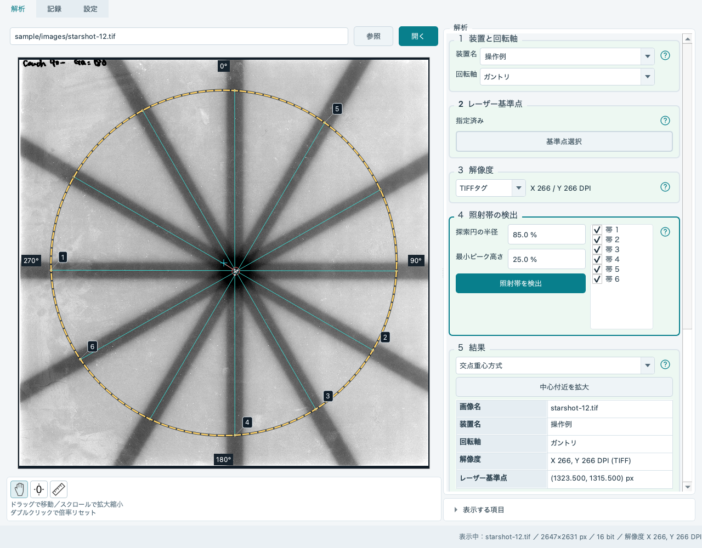
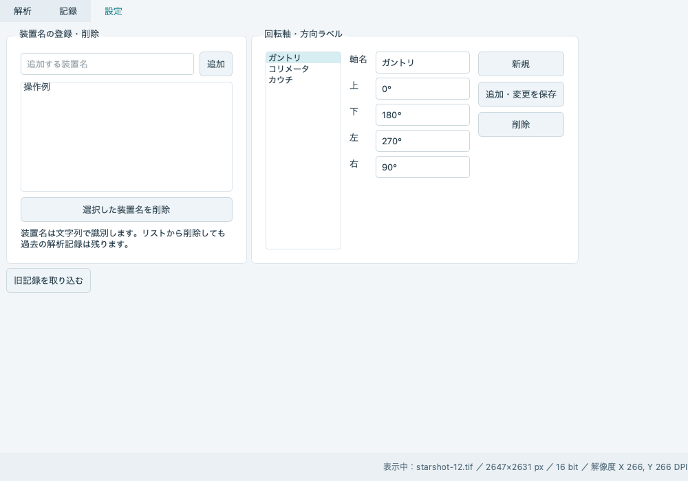
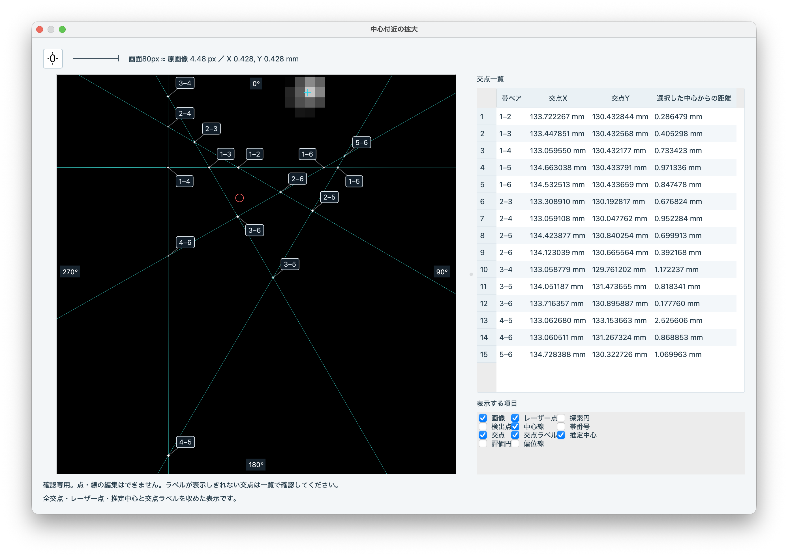
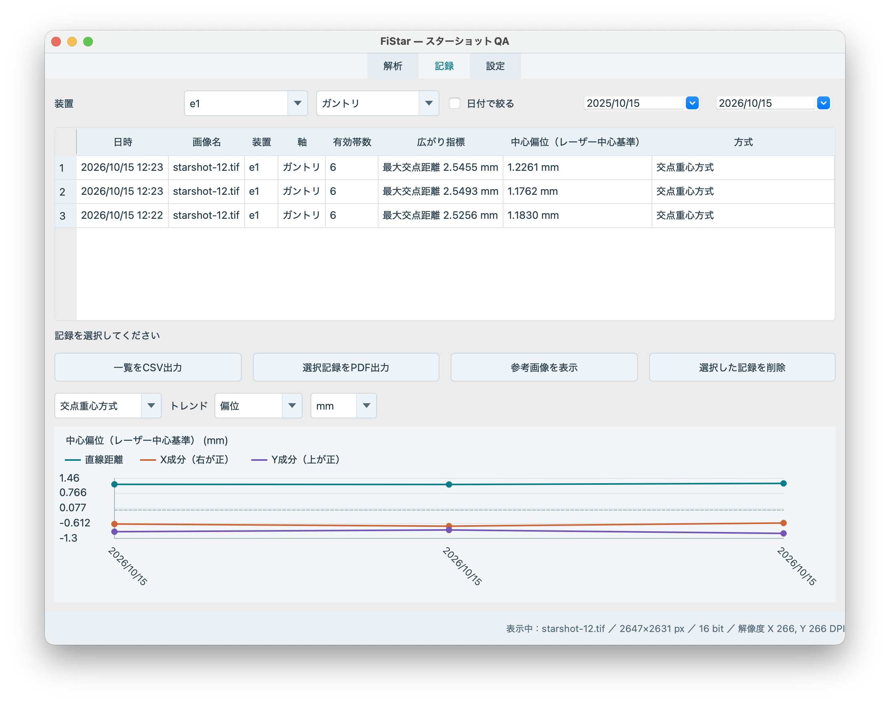

# FiStar 操作マニュアル

フィルムスキャンTIFFを用いた2Dスターショットの解析・記録・レポート出力

更新：2026年10月14日

## 1. はじめに・基本の流れ

FiStarは、画像から照射帯の中心線を検出し、推定中心とレーザー基準点の位置関係を調べるソフトです。

施設内QAの補助ツールです。検出した線・基準点・解像度を確認し、施設の手順に従って判断してください。

画面例は付属のstarshot-12.tifを実際に解析したものです。レーザー基準点を画像中央へ仮指定し、TIFFタグの解像度を使用しています。数値は操作説明用の例で、基準点や解析精度の正しさを保証するものではありません。

### 簡易操作解説

1. FiStar.exeまたはFiStar.appから起動してください。
2. 「参照」で解析するTIFF画像を選び、画像を開きます。
3. 「1 装置と回転軸」で装置名と軸を指定します。装置名は空欄でも保存できます。
4. 「2 レーザー基準点」の「基準点選択」を押し、画像上を左クリックします。
5. 「3 解像度」でDPI入力・TIFFタグ・mm/px入力・未校正を選びます。初回はDPI入力です。
6. 「4 照射帯の検出」の「照射帯を検出」を押します。
7. 結果が自動で処理済みになったら、検出線と数値を確認し、結果枠の「保存」を押します。

入力や検出結果が不足している間は保存できません。
画面右側が見切れる場合は、解析欄をスクロールしてください。

<!-- pagebreak -->

## 2. 初期設定

### 設定タブ

画面上部から設定タブを開いて、装置名と回転軸・方向ラベルを任意に設定できます。

### 装置名

装置名を入力して「追加」を押すと、解析タブの装置名候補に登録されます。削除する場合はリストで選び、「選択した装置名を削除」を押します。装置名を削除しても過去の記録は削除されません。

### 回転軸・方向ラベル

- 追加：「新規」→軸名と上・下・左・右を入力→「追加・変更を保存」。
- 編集：左のリストで軸を選択→入力欄を書き換え→「追加・変更を保存」。
- 削除：リストで軸を選択→「削除」。少なくとも1軸は残してください。

| 初期の軸名 | 上  | 下   | 左   | 右  |
| ---------- | --- | ---- | ---- | --- |
| ガントリ   | 0°  | 180° | 270° | 90° |
| コリメータ | G   | T    | 270° | 90° |
| カウチ     | H   | F    | L    | R   |

方向ラベルは画像の四辺に表示します。

<!-- pagebreak -->

## 3. 解析手順

### 画像読みこみ

「参照」でファイルを選ぶと、そのまま読み込みます。パス欄へ直接入力し、「開く」またはEnterでも読み込めます。

解析対象はTIFF画像です。

### 画像の操作

画像読み込み時、デフォルトでは画像移動ツールが選択されています。

| 操作                                 | 動作                             |
| ------------------------------------ | -------------------------------- |
| 手のアイコン・通常の左ドラッグ       | 画像を移動                       |
| 上スクロール／下スクロール           | 拡大／縮小。現在の表示中心が基準 |
| リセットアイコン／ダブルクリック     | 画像全体を表示                   |
| 定規アイコン→画像内の2点を左クリック | 2点間の長さを測定                |

### 解析フレームとヘルプ

画面右側には解析フレームが縦に並べられており、解析はそれらを順に設定することで行われます。フレームの背景色でそのフレーム内での入力・処理項目が満たされているかを判別できます。

| 表示           | 意味                 |
| -------------- | -------------------- |
| 青緑の枠線     | 選択中の編集対象     |
| 淡い緑の背景   | 設定済み／結処理済み |
| 淡い黄の背景   | 入力・処理が未完了   |
| オレンジの背景 | 再検出が必要         |

Ctrl＋PageDown／PageUpで次のフレームを選べます。

各枠の右上にあるヘルプへ約1秒マウスを置くか、クリックすると説明が開きます。

### 装置と回転軸

装置名の入力または選択を行います。候補を選ぶと入力欄を上書きします。手入力した名前は候補リストへ自動登録はされません。装置名は文字列で区別されるため、同じ装置には表記を揃えてください。未入力でも解析・結果保存は可能です。

解析する画像の回転軸を選択します。ここで選択した回転軸とそれに設定されている方向ラベルは、結果の分類と画像上の四方に表示するラベルに使用します。

### レーザー基準点

1. 必要に応じて画像を拡大し、基準にする穴・印の位置を確認します。
2. 解析欄の「基準点選択」を押します。
3. 画像上の位置を左クリックします。指定後は自動で画像移動モードへ戻ります。

基準点選択中はShift＋左ドラッグで画像を移動できます。修正するときは、再度「基準点選択」を押して左クリックします。選択ボタンを再度押すか、手のアイコンを押すと選択状態を解除できます。

### 表示する項目

解析欄の下にある「表示する項目」を開くと、レーザー点、探索円、検出点、中心線、帯番号、交点、交点ラベル、推定中心、評価円、偏位線を切り替えられます。交点ラベルは初期OFFです。

表示設定は起動中だけ保持します。見づらいときは不要な表示を一時的にOFFにしてください。中心線の手動追加・移動・回転はできません。

<!-- pagebreak -->

### 解像度の設定・定規による校正

解像度設定をすることでピクセルあたりの長さを設定し、結果表示にmm単位で反映できます。不明な場合はピクセル単位での設定か、定規ツールの校正機能で既知の長さを測定することで設定可能です。

| 方法      | 操作と結果                                   |
| --------- | -------------------------------------------- |
| DPI入力   | 1インチあたりの画素数を入力。                |
| TIFFタグ  | 画像のX/Y解像度をそれぞれDPIで表示して使用。 |
| mm/px入力 | 1画素あたりの長さをmmで入力。                |
| 未校正    | px単位で解析・保存。mmとして扱いません。     |

#### 既知の長さから校正する

1. 定規アイコンを押し、その右の「校正」を押します。
2. 入力欄に既知の長さをmmで入力します。
3. その長さに対応する両端を画像内で左クリックします。
4. 計算された解像度と測定値を確認します。画像下端の解像度はDPI表示です。

<!-- pagebreak -->

### 照射帯の検出

「照射帯を検出」を押すと、レーザー基準点を中心とした円周上で暗い帯を検出します。初期値は探索円の半径85%、最小ピーク高さ25%です。円周の反対側にある腕同士を結び、1本の中心線にします。

#### 探索円の半径

基準点から最も近い画像端までの距離を100%とする割合です。その距離が100pxなら、85%で半径85pxになります。値を変えると探索円の表示が更新されます。

円が各照射帯を横切る位置になるよう調整します。帯が重なりすぎる中央付近や、帯が途切れる位置を避けられているか、画像を見ながら確認してください。

#### 最小ピーク高さ

円周上の濃淡を一周読み取り、暗い照射帯を山（ピーク）として扱います。円周データの最低値を0にし、最も高い山を100%としたときの、採用候補の下限です。

25%なら、最高の山の高さが100のとき、高さ30の山は候補、高さ20の山は対象外です。ピーク間の間隔など、ほかの検出条件も適用されます。

| 変更       | 起こりやすいこと                                             |
| ---------- | ------------------------------------------------------------ |
| 値を下げる | 薄い帯を拾いやすくなる一方、ノイズも拾いやすくなる           |
| 値を上げる | 小さなノイズを除きやすくなる一方、薄い帯を見落とすことがある |

この割合は照射線量の割合ではありません。また、検出した帯の中心を求める「半値幅の50%」とは別の設定です。

#### 検出後の確認

- 中心線が各照射帯に沿っているか、帯番号と一覧の本数を確認します。
- 不要な帯は一覧のチェックを外して除外します。再びチェックすると有効に戻ります。
- 検出が足りない・余分な帯がある場合は条件を調整し、再検出します。線を手動で追加・移動・回転する機能はありません。

レーザー基準点・半径・ピーク高さを変更した後は再検出が必要です。再検出中や失敗後も旧線・結果は保持しますが、保存は止まります。成功すると自動で処理済みに戻ります。条件を自動で探し直す処理はありません。

<!-- pagebreak -->

### 結果

#### 中心推定方式

| 方式         | 推定中心                                             | 広がりの値                                   |
| ------------ | ---------------------------------------------------- | -------------------------------------------- |
| 交点重心方式 | 有効な中心線の全ペアの交点を等しい重みで平均した位置 | 最大距離：推定中心から最も遠い交点までの距離 |
| 最小円方式   | 各中心線への垂直距離の最大値を最小にする位置         | 最大半径：その中心から中心線への最大垂直距離 |

方式を切り替えても照射帯の再検出は行いません。同じ有効中心線を使って表示する結果を切り替えます。どちらも3方向以上の有効な中心線が必要です。

#### 中心偏位（レーザー中心基準）

レーザー点を起点に、推定中心がどちらへどれだけ離れているかを示します。

| 表示値    | 意味                                       |
| --------- | ------------------------------------------ |
| 直線距離  | レーザー点と推定中心の距離。負にはならない |
| Xが正／負 | 推定中心がレーザー点より右／左             |
| Yが正／負 | 推定中心がレーザー点より上／下             |

例：X＝+0.3mm、Y＝−0.4mmは、推定中心がレーザー点より右へ0.3mm、下へ0.4mmで、直線距離は0.5mmです。

**位置を表す座標と、偏位の成分はYの向きが異なります。** 中心・交点の画像座標は右・下方向に増加します。偏位は右・上が正です。方向ラベルを変更しても、この符号は変わりません。

#### 交点重心方式での注意

同じ場所に重なる交点もペアごとに数えます。平行・同一直線のペアは交点を定義できず、平均から除外します。ほぼ平行な線の遠方交点や画像外の交点は自動除外されません。1度未満の線間角度には警告が出るため、一覧で確認してください。

### 保存

必要な入力と有効な検出結果が揃うと、結果枠が自動で処理済みになり、淡い緑になります。画像・基準点・解像度・中心線・数値を確認し、枠内右下の「保存」を押します。装置名は空欄でも保存できます。

校正未完了、再検出が必要な状態、有効な線の不足、選択方式が計算不能な状態では保存できません。

<!-- pagebreak -->

### 中心付近の拡大で確認する

「5 結果」の「中心付近を拡大」を押すと、確認専用の別ウィンドウを開きます。

starshot-12.tifの操作例です。

左に拡大画像、右に交点一覧と表示項目があります。画像の倍率は、レーザー点・選択方式の推定中心・全交点とラベルが収まるよう自動設定されます。

- 水色はレーザー点、赤は交点重心、紫は最小円中心、白は交点です。
- 「1–2」などのラベルは、交差する帯番号のペアです。同じ位置の交点はラベルをまとめます。
- 左ドラッグで移動、スクロールで拡大縮小できます。リセットまたはダブルクリックで全点を収めます。
- 右側の一覧には交点X/Yと選択した中心からの距離を表示します。画像外の交点も一覧に残ります。
- 表示チェックはメインと独立しています。点や線の編集はできません。

遠方の交点があると全体を収めるため倍率が低くなります。確認したい部分へ手動で拡大し、全体の確認時はリセットしてください。スケールは元画像px数、校正済みの場合はX/Yのmm値も表示します。

<!-- pagebreak -->

## 4. 記録・トレンド・CSV

### 記録の検索と参考画像

「記録」タブの装置・軸で絞り込みます。期間を指定する場合は「日付で絞る」をONにし、開始日と終了日を指定します。

記録を1件選び「参考画像を表示」を押すと、解析結果画像と中心線・交点を閲覧できます。

Ctrlキー（macOSはCommandキー）を押しながらクリックすると複数の記録を選べます。Shiftキーでは連続した範囲を選べます。「選択した記録を削除」を押し、確認画面で承認すると、選択した記録を削除します。

### トレンド

装置と軸を選択すると表示します。初期方式は交点重心方式、初期指標は偏位です。単位はmm／pxから対象の記録に合わせて選んでください。

- 偏位：直線距離・X成分・Y成分を同じグラフで色分け表示します。
- 最大距離：交点重心から最も遠い交点までの距離です。
- 最大半径：最小円方式の半径です。方式に応じて名称が変わります。

横軸は測定日時順の等間隔です。斜めの日付ラベルを表示し、期間の空白で点の間隔は広がりません。画面に多数の記録を表示する場合は、日付の新しい順に15件までを表示します。

### CSV出力

「一覧をCSV出力」で、現在の絞り込みに該当する一覧をUTF-8のCSVへ出力します。方式、中心、偏位X/Y、広がり、交点数などを含みます。

<!-- pagebreak -->

## 5. PDFレポートを出力する

1. 記録タブで出力したい記録を選びます。
2. トレンドに使う期間があれば「日付で絞る」で指定します。
3. 「選択記録をPDF出力」を押します。
4. 任意のコメントを入力します（500文字まで・空欄可）。
5. 保存先を指定します。コメントはPDFだけに使用し、記録には保存しません。

### 掲載内容

| ページ       | 内容                                                                       |
| ------------ | -------------------------------------------------------------------------- |
| 1ページ目    | 基本情報・結果の表、全体画像、偏位と最大距離／最大半径のトレンド、コメント |
| 2ページ目    | 中心付近の拡大画像、帯ペアと推定中心からの距離の一覧                       |
| 続きのページ | 交点が多い場合の一覧の続き                                                 |

### PDFのトレンド条件

選択記録と同じ装置名・軸・方式・結果の単位を対象に、指定期間内の最新15件を掲載します。期間指定がなければ全期間から最新15件です。装置名の空欄も同一の名前として扱います。

最新15件に含まれない場合などは対象外の注記が出ます。選択記録より後の測定も、期間内なら対象に含みます。

<!-- pagebreak -->

## 6. 保存先・バックアップ・困ったとき

### 保存先とバックアップ

解析記録は、FiStarフォルダ内に存在する「data」フォルダへ保存します。DBは「fistar-v1.sqlite」、前回の画像パス・軸・解像度方式・有効な入力値は「fistar-preferences.ini」、参考JPEGは「images」フォルダです。初回起動時に作成します。

移植・バックアップはアプリを終了して「data」フォルダ全体をコピーしてください。元TIFFは移植に不要です。アプリ更新時はdataを保持し、アプリとライブラリだけ差し替えます。

### 実行ファイル版の起動

Windows版は配布されたZIP全体を展開し、フォルダ内の「FiStar.exe」を起動します。exeと同梱ファイルは一緒に保管してください。macOS版は同様に「FiStar.app」を起動します。

画面表示後、解析機能をバックグラウンドで準備します。準備中も画像選択などの操作は可能です。「照射帯を検出」を押すと準備完了後に実行します。初回の準備情報はキャッシュに保存し、次回以降に再利用します。準備中に画像・基準点・検出条件を変えた場合は、再度検出してください。準備に失敗した場合は「解析準備を再試行」を押します。

### 主な症状と対処

| 症状                              | 確認すること                                                                                       |
| --------------------------------- | -------------------------------------------------------------------------------------------------- |
| 検出ボタンを押せない              | 画像、レーザー基準点、解像度設定が完了しているか確認。校正中なら完了または中止する。               |
| TIFFタグを使用できない            | DPI入力・mm/px入力・定規校正・未校正から選ぶ。                                                     |
| 検出点が奇数／6点未満             | 基準点と探索円を確認し、半径・最小ピーク高さを調整して再検出する。                                 |
| 薄い帯を拾えない                  | 最小ピーク高さを少し下げる。探索円が帯を横切っているかも確認する。                                 |
| 余分な帯を拾う                    | 最小ピーク高さを少し上げるか、不要な帯を一覧で除外する。                                           |
| 「再検出が必要」と表示            | 基準点・半径・ピーク高さを変更した後に「照射帯を検出」を押す。                                     |
| 中心が遠い／最大距離が大きい      | ほぼ平行な線、遠方の交点、除外漏れを拡大画像と一覧で確認する。                                     |
| トレンドが出ない                  | 装置と軸を個別に選び、期間・方式・mm／pxが対象の記録と合うか確認する。                             |
| 保存ボタンを押せない              | 未完了の校正、再検出の案内、有効な線の不足、計算不能を確認。保存済みで変更がない場合も無効になる。 |
| 参考画像が表示できない            | data/imagesのJPEGを確認。画像がなくても数値は閲覧・出力できる。                                    |
| PDFで日本語が出ない／出力できない | 日本語フォントの利用可否、保存先への書込み権限、表示されたエラーを確認する。                       |

検出にはPylinac 3.48.0を使用します。ライセンスはプロジェクトの「THIRD_PARTY_NOTICES.md」、検証範囲は「docs/validation-v1.md」を参照してください。
